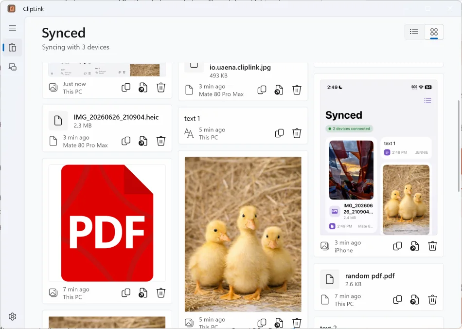
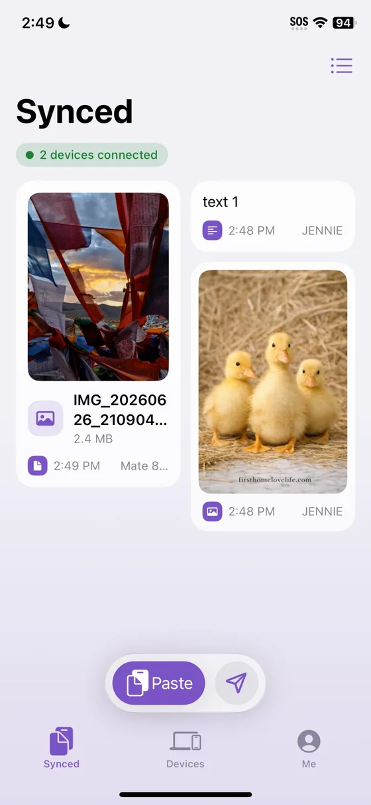
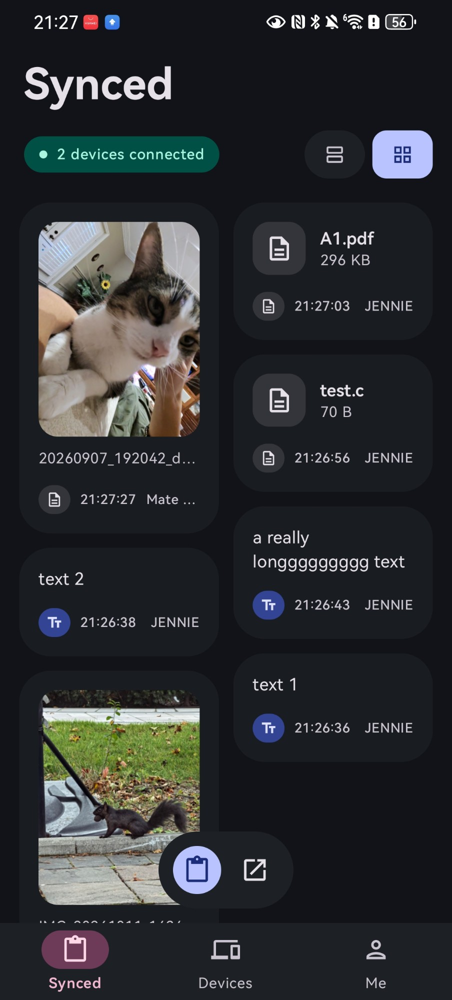
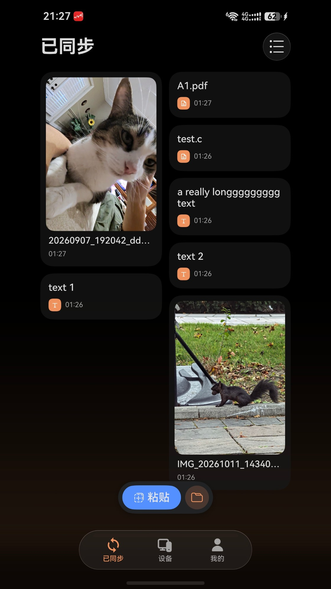

<div align="center">

# ClipLink

### Copy on one device. Paste on another.

## 🌐 [cliplink.uaena.io](https://cliplink.uaena.io)

Downloads, how to set up, and help &nbsp;·&nbsp; [中文](https://cliplink.uaena.io/zh/)

</div>

ClipLink sends what you copy (text, pictures and files) to your other devices. It works on Windows, Android, HarmonyOS and iPhone.

- **No account.** There is nothing to sign up for.
- **No cloud.** What you copy goes straight from one of your devices to another. There is no ClipLink server.
- **Private.** Devices must be paired first, and everything they send each other is encrypted.
- **Free and open source.**

<p align="center">
  
</p>
<p align="center">
  
  &nbsp;
  
  &nbsp;
  
</p>

## Get it

| Device | How |
| --- | --- |
| **Windows** | Download `ClipLink-Setup-2.0.0.exe` from [Releases](https://github.com/Colour1205/ClipLink/releases/latest) |
| **Android** | Download `ClipLink-2.0.0.apk` from [Releases](https://github.com/Colour1205/ClipLink/releases/latest) (Android 12 or newer). Google Play is coming soon |
| **HarmonyOS** | Coming soon |
| **iPhone** | Coming soon |

The Windows installer is not signed yet, so Windows may say the publisher is unknown. Choose **More info**, then **Run anyway**.

## How to use it

1. **Install** ClipLink on each device.
2. **Pair** them. Scan a QR code, type in the other device's address, or set the same passcode on both.
3. **Copy** on one device. It shows up on the others.

Your devices need to reach each other: on the same Wi-Fi, or through a VPN such as Tailscale.

## Privacy

ClipLink does not collect anything. Read the [privacy policy](https://cliplink.uaena.io/privacy.html).

## For developers

- How it works: [architecture](docs/architecture.md), [protocol](docs/protocol.md) and [security](docs/security.md)
- The apps: [`windows/`](windows/), [`mobile/android/`](mobile/android/), [`mobile/harmonyos/`](mobile/harmonyos/) and [`mobile/ios/`](mobile/ios/). Each folder has its own README with build steps.
- The website is in [`site/`](site/).

To build the Windows app (needs the .NET 10 SDK):

```powershell
powershell -ExecutionPolicy Bypass -File windows\publish.ps1
```

## License

ClipLink is open source under the [Apache License 2.0](LICENSE).
